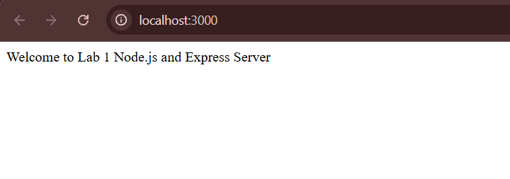
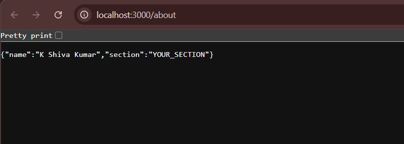
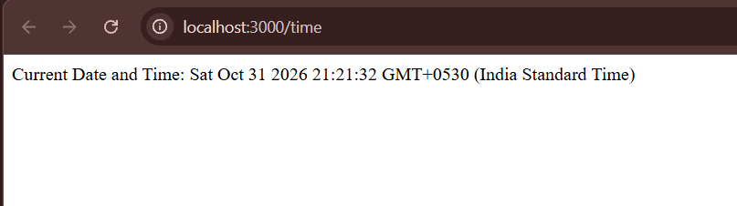
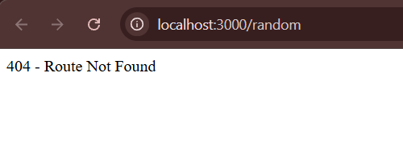

# Lab 1: Node.js and Express server

## Student Details
- **Name:** K Shiva Kumar
- **Registration Number:** 252U1R8035
- **Section:** CSE(QE)-2A
---

## Live Link
Not deployed yet

---

## Project Description
This project demonstrates the fundamentals of building web servers in Node.js:
1. Creating a plain Node.js server using the built-in `http` module (`server-http.js`).
2. Creating an Express.js server (`server.js`) implementing RESTful GET routes and proper HTTP status code handling (including 404 for unknown endpoints).

---

## Understanding `package.json`
- `name`: Identifies the project/package name (`lab-01`).
- `version`: Indicates current semantic version (`1.0.0`).
- `description`: A brief summary of the package purpose.
- `main`: Entry point file of the application (`server.js`).
- `scripts`: Shortcut commands executable via `npm run <script-name>` (e.g., `npm start`, `npm run start:http`).
- `dependencies`: Lists required third-party npm packages installed for production (`express`).
- `license`: Open-source license governing usage (`ISC`).

---

## How to Run

### 1. Prerequisites
- [Node.js](https://nodejs.org/) (v18 or higher recommended)
- `npm` (bundled with Node.js)

### 2. Installation
Navigate into the `lab-01` directory and install dependencies:
```bash
cd lab-01
npm install
```

### 3. Running the Plain Node.js HTTP Server
```bash
node server-http.js
# Or using npm script:
npm run start:http
```
The server will start at `http://localhost:3000/` and respond with `"Hello"`.

> **Note:** Stop the HTTP server (`Ctrl + C`) before starting the Express server, as both use port 3000.

### 4. Running the Express Server
```bash
node server.js
# Or using npm script:
npm start
```
The Express server will start at `http://localhost:3000/`.

---

## Endpoints

| Method | Path | Status Code | Description | Example Response |
|---|---|---|---|---|
| GET | `/` | 200 OK | Returns the welcome message | `Welcome to Lab 1 Node.js and Express Server` |
| GET | `/about` | 200 OK | Returns student details as JSON | `{"name":"K Shiva Kumar","section":"CSE(QE)-2A"}` |
| GET | `/time` | 200 OK | Returns current date and time using `new Date()` | `Current Date and Time: ...` |
| GET | Any unknown path (e.g. `/random`) | 404 Not Found | Returns a 404 error message | `404 - Route Not Found` |

---

## Screenshots

### 1. Home Route (`GET /`)


### 2. About Route (`GET /about`)


### 3. Time Route (`GET /time`)


### 4. 404 Not Found Route (`GET /random`)


---

## Notes
- **Problems Faced:** Port conflicts when attempting to run both the plain `http` server and Express server simultaneously.
- **Solution:** Closed the plain HTTP server process before launching the Express server on port 3000.

