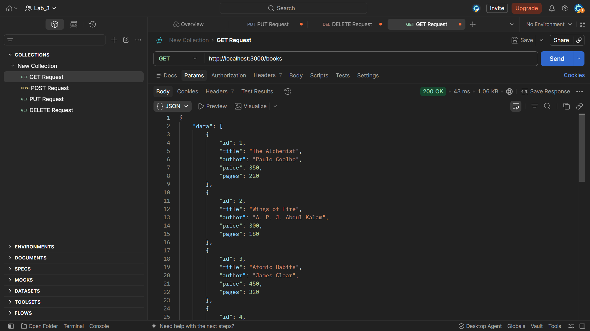
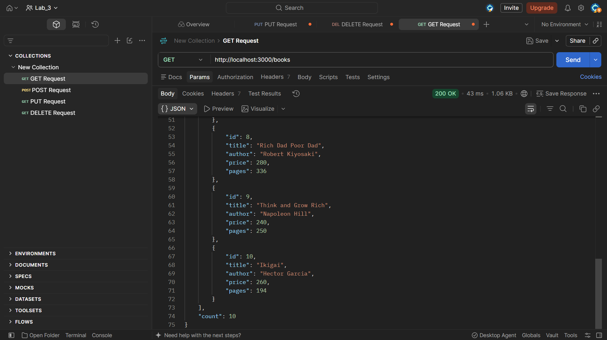
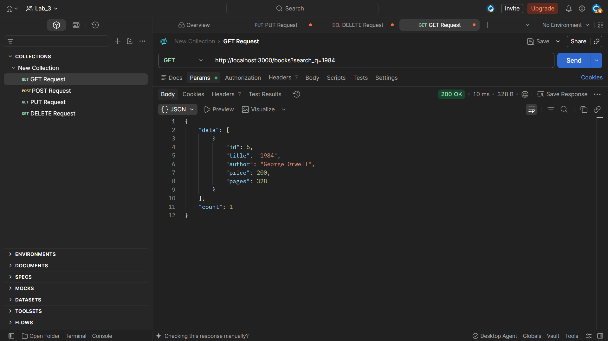
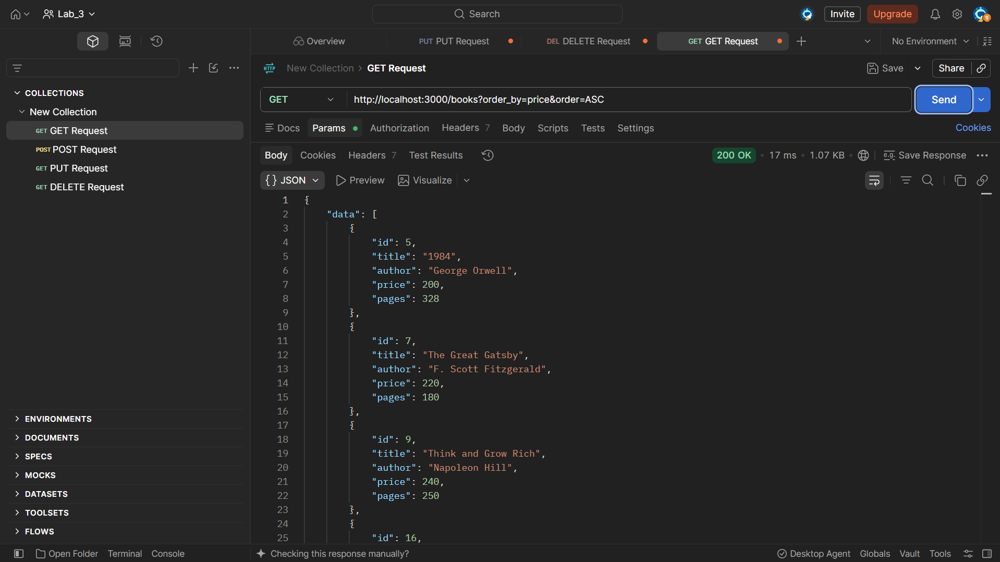
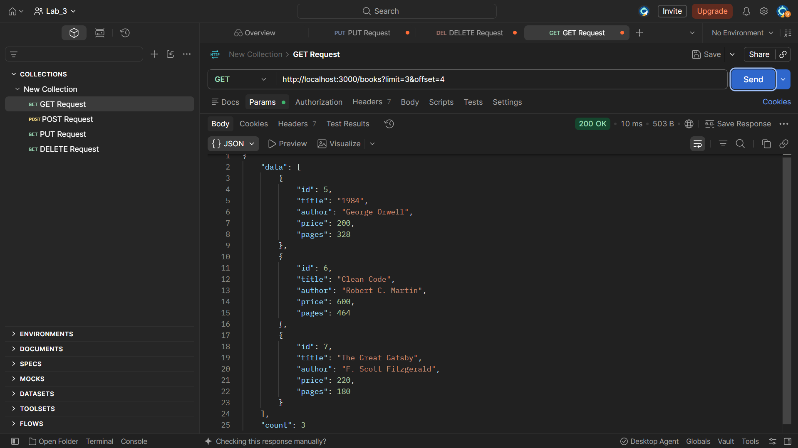
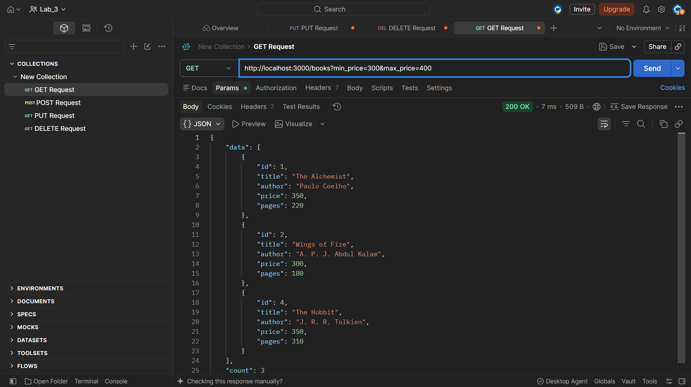
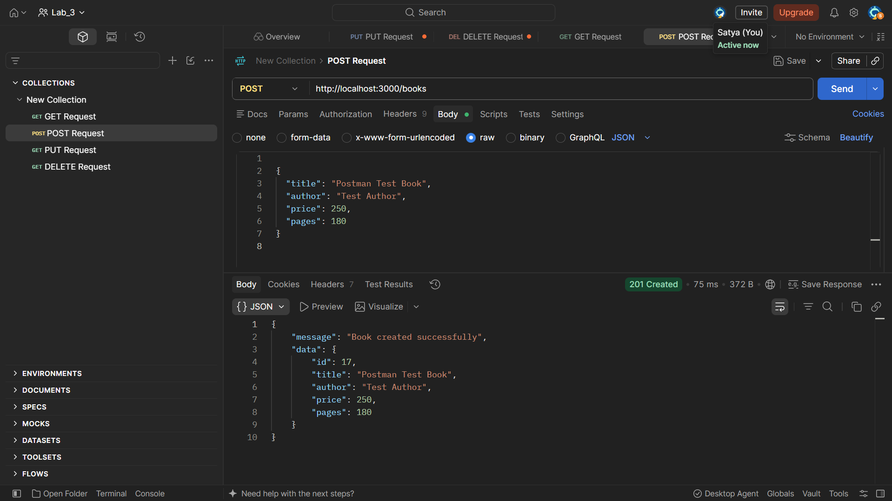
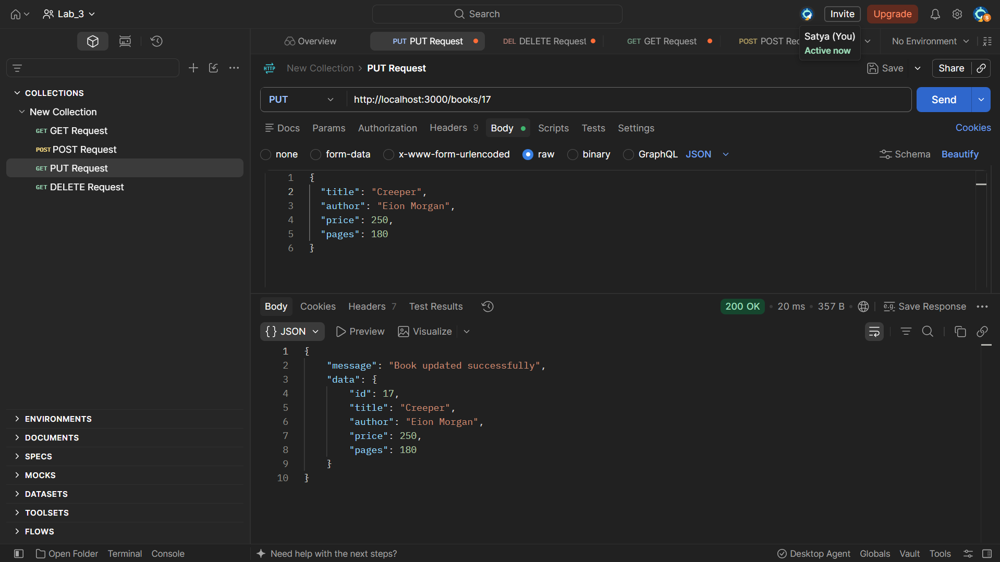
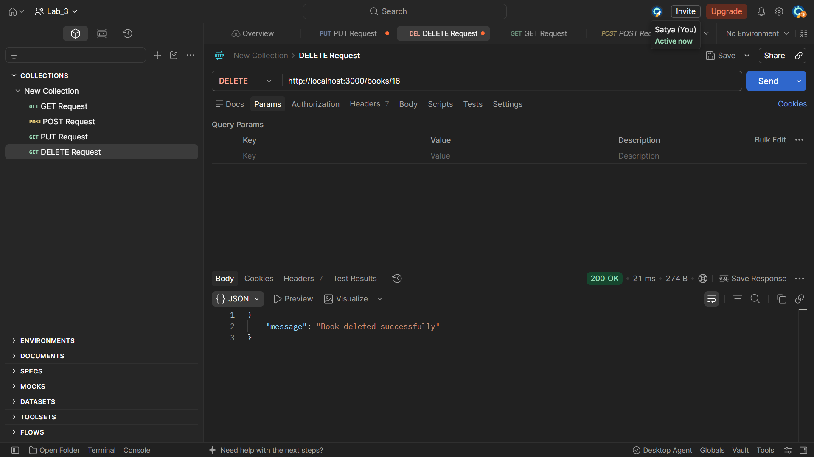

# Lab 3: REST API, Query Parameters, Validation and Debugging

## Student Details

- **Name:** K.Shiva kumar
- **Registration Number:** 252U1R8035
- **Section:** CSE(QE)-2A-113
- **Course:** Backend Development Fundamentals

## Objective

To develop RESTful APIs using Express.js and SQLite by implementing search, sorting, pagination, price filtering, request validation, proper HTTP status codes, and consistent error handling. The objective also includes testing API endpoints using Postman and debugging common backend development errors.

## Technologies Used

- Node.js
- Express.js
- SQLite
- sqlite3
- sqlite
- Nodemon
- Postman
- Git and GitHub
- Render

## Project Structure

```text
lab-03/
├── app.js
├── package.json
├── package-lock.json
├── .gitignore
├── README.md
├── README_Lab3.md
├── render.yaml
├── books.db
├── node_modules/
└── screenshots/
```

**Note:** The `books.db` and `node_modules/` folders are kept locally and excluded from GitHub using `.gitignore`. The database is initialized by the application when required.

## Installation and Setup

### Prerequisites

Install Node.js and npm. Postman is recommended for testing the API endpoints.

### Install dependencies

Open a terminal inside the `lab-03` folder and run:

```bash
npm install
```

Install the SQLite dependencies:

```bash
npm install sqlite sqlite3
```

### Start the server

To start the application:

```bash
npm start
```

For development with automatic restarts, if the development script is configured:

```bash
npm run dev
```

The server runs at:

`http://localhost:3000`

### Environment Variables

The application uses the following environment variables when configured:

| Variable | Description | Default |
|---|---|---|
| PORT | Server port | 3000 |
| DB_PATH | SQLite database location | ./books.db |

No API credentials or external database credentials are required for the local setup.

## Database Details

The SQLite database file is named `books.db`.

The table is named `book` and contains the following columns:

| Column | Data type | Description |
|---|---|---|
| id | INTEGER PRIMARY KEY AUTOINCREMENT | Unique book ID |
| title | TEXT NOT NULL | Book title |
| author | TEXT NOT NULL | Author's name |
| price | INTEGER NOT NULL | Book price |
| pages | INTEGER NOT NULL | Number of pages |

The application creates the table if it does not exist and inserts 10 sample books when the table is empty.

## REST API Endpoints

Base URL:

`http://localhost:3000`

| Method | Endpoint | Description |
|---|---|---|
| GET | `/` | Check server availability |
| GET | `/books` | Retrieve books with search and filtering |
| GET | `/books/:bookId` | Retrieve a book by ID |
| POST | `/books` | Add a new book |
| PUT | `/books/:bookId` | Update an existing book |
| DELETE | `/books/:bookId` | Delete a book |

### 1. Get all books

**Request:** `GET /books`

Returns all books as a JSON array.

Expected status: `200 OK`

### 2. Search books using query parameters

**Request:** `GET /books?search_q=harry`

Searches for books whose titles partially match the provided search text.

Expected status: `200 OK`

### 3. Sort books

**Request:** `GET /books?order_by=price&order=DESC`

Sorts books according to the specified column and order.

Supported sorting columns:

- id
- title
- author
- price
- pages

Sorting order can be `ASC` or `DESC`.

Expected status: `200 OK`

### 4. Pagination

**Request:** `GET /books?limit=3&offset=0`

Returns a limited number of records.

- `limit` specifies the maximum number of books returned.
- `offset` specifies the number of records to skip.
- Default limit is 10.
- Maximum allowed limit is 100.
- Default offset is 0.

Expected status: `200 OK`

### 5. Filter books by price range

**Request:** `GET /books?min_price=100&max_price=500`

Returns books within the specified minimum and maximum price range.

Expected status: `200 OK`

### 6. Get one book

**Request:** `GET /books/1`

Returns the book with the specified ID.

Expected status: `200 OK` if found, or `404 Not Found` if the book does not exist.

### 7. Add a new book

**Request:** `POST /books`

Select Body → raw → JSON in Postman.

Example request body:

```json
{
  "title": "Database Fundamentals",
  "author": "John Smith",
  "price": 400,
  "pages": 300
}
```

The API validates the request body before inserting the book into the database.

Expected status: `201 Created` if the book is successfully added.

### 8. Update an existing book

**Request:** `PUT /books/1`

Example request body:

```json
{
  "title": "The Alchemist - Updated",
  "author": "Paulo Coelho",
  "price": 350,
  "pages": 220
}
```

Updates the details of the specified book.

Expected status: `200 OK` if updated, or `404 Not Found` if the book does not exist.

### 9. Delete a book

**Request:** `DELETE /books/1`

Replace `1` with the actual ID of the book to delete.

Expected status: `200 OK` if the book is deleted, or `404 Not Found` if it does not exist.

## Request Validation

The API validates incoming data before performing database operations.

The following validations are implemented:

- Title must be provided and cannot be empty.
- Author must be provided and cannot be empty.
- Price must be a valid non-negative number.
- Pages must be a positive integer.

Invalid requests return `400 Bad Request` with a clear JSON error message.

Example invalid request:

```json
{
  "title": "Invalid Book",
  "author": "Test Author",
  "price": "abc",
  "pages": 180
}
```

Expected status: `400 Bad Request`.

## Error Handling

The API uses appropriate HTTP status codes and consistent JSON error responses.

| Status Code | Description |
|---|---|
| 200 OK | Request completed successfully |
| 201 Created | New book successfully created |
| 400 Bad Request | Invalid request data or parameters |
| 404 Not Found | Requested book does not exist |
| 500 Internal Server Error | Unexpected server or database error |

Example error response:

```json
{
  "message": "Book not found"
}
```

Database queries that use user input are implemented with parameterized SQL queries using `?` placeholders to help prevent SQL injection.

## Testing with Postman

The following tests were performed during development:

- Retrieve all books.
- Search books using partial title matching.
- Sort books in ascending and descending order.
- Retrieve books using limit and offset.
- Filter books using minimum and maximum prices.
- Retrieve a book by ID.
- Add a new book with valid data.
- Check validation errors for missing title.
- Check validation errors for missing author.
- Check validation errors for nonnumeric price.
- Update an existing book.
- Check update operation for a nonexistent book ID.
- Delete an existing book.
- Check deletion of a nonexistent book ID.
- Verify appropriate HTTP status codes and JSON responses.

All the above API tests were performed successfully using Postman.

## Screenshots

Add screenshots of the actual Postman request and response results in the `screenshots/` folder.

### 1. Get all books




### 2. Search books



### 3. Sort books



### 4. Pagination



### 5. Price range filtering



### 6. Add a book




### 7. Update a book



### 8. Delete a book




## Debugging Common Errors

The following common backend development errors were studied during the experiment:

**1. EADDRINUSE**

This error occurs when the requested port is already being used by another process.

**Solution:** Stop the process using the port or configure the application to use a different port.

**2. Incorrect Import Path**

This error occurs when the imported module path or filename is incorrect.

**Solution:** Verify the file name, relative path, and ES module import statements.

**3. No Such Table**

This error occurs when the SQL query refers to a database table that does not exist or uses an incorrect table name.

**Solution:** Verify the database connection and ensure the correct table name, `book`, is used.

**4. Missing Await**

This issue occurs when an asynchronous database operation is not properly awaited.

**Solution:** Use `async` and `await` to ensure database operations complete before their results are used.

## Deployment

**Platform:** Render

**GitHub Repository:**  
https://github.com/koukuntlashiva333-droid/BACKEND_LAB_REPORT
**Live URL:** 


The application is configured for deployment using the `render.yaml` configuration file.

The server uses the `PORT` environment variable and listens on `0.0.0.0` for deployment compatibility.

## Problems Faced and Solutions

**Implementing RESTful API Endpoints:** Converting the existing routes into RESTful API endpoints required proper use of HTTP methods and resource-based URLs.

**Solution:** Organized the API using `/books` and `/books/:bookId` endpoints with GET, POST, PUT, and DELETE methods.

**Implementing Search and Filtering:** Retrieving books based on partial title matches and price ranges required dynamic SQL queries.

**Solution:** Used query parameters and parameterized SQL queries to implement searching and filtering.

**Sorting and Pagination:** Retrieving records in a specific order and displaying limited results required sorting and pagination.

**Solution:** Implemented `order_by`, `order`, `limit`, and `offset` query parameters.

**Request Validation:** Invalid input data could cause incorrect database operations.

**Solution:** Added validation for required fields, numeric price values, and positive page counts before processing requests.

**Handling HTTP Status Codes:** Different API operations required appropriate response status codes.

**Solution:** Implemented 200, 201, 400, 404, and 500 status codes with consistent JSON error messages.

**Debugging Backend Errors:** Common issues such as port conflicts, incorrect imports, missing database tables, and missing `await` statements needed to be identified and resolved.

**Solution:** Verified server configuration, database initialization, import paths, and asynchronous operations.

**Testing API Endpoints:** Each endpoint needed to be checked to ensure it returned the expected response.

**Solution:** Tested successful requests and failure cases using Postman and verified the returned status codes and JSON responses.

## Conclusion

The project successfully implements RESTful APIs using Express.js and SQLite. It demonstrates resource-based routing, search functionality, sorting, pagination, price range filtering, request validation, proper HTTP status codes, consistent error handling, and debugging techniques.

All API endpoints were tested successfully using Postman. This experiment provided practical experience in developing, validating, testing, and preparing a REST API for deployment.
